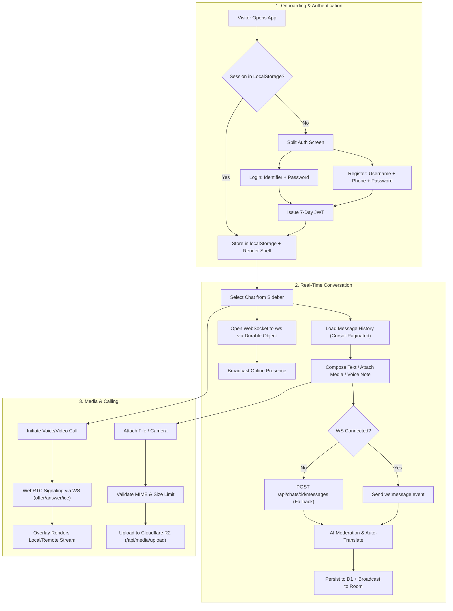
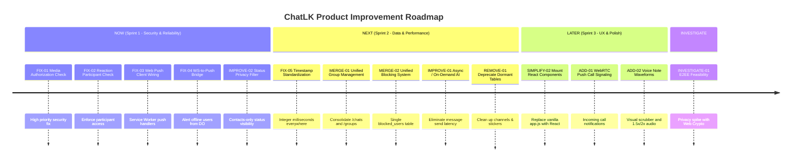

# ChatLK: Product Improvement & Feature Planning Report

**Document Version:** 1.0.0  
**Target Application:** ChatLK (Mobile-First Real-Time Messaging Platform for Sri Lanka)  
**Evaluator Roles:** Senior Product Manager, Product Designer, Software Architect, UX Researcher, Technical Analyst  
**Environment Inspected:** Local Workspace (`/root/inclusive-eyes-chatlk`), Git Branch `main`, Target Cloudflare Workers Production (`https://chatlk.agent-1xfast-srilanka.workers.dev`)

---

## 1. Executive Summary

### 1.1 Current Product Condition
ChatLK is an ambitious, mobile-first, multilingual (Sinhala, Tamil, English) messaging application tailored for Sri Lankan users. It runs on a hybrid stack combining a **Hono** backend deployed across **Cloudflare Workers**, **D1 SQLite** storage, **KV** rate limiting, **R2** object storage, **Workers AI**, and **Durable Objects** for real-time WebSocket messaging and presence. 

While the core messaging foundation works and all 36 unit/integration tests pass (`npm test`), the application suffers from **architectural bifurcation**, **critical security/authorization leaks**, **data contract discrepancies**, and **dormant feature debt**:
1. **Parallel Frontend Split**: The production application runs on a 286-line monolithic vanilla JavaScript script (`src/static/js/app.js`), while a suite of polished React/TypeScript components (`src/components/`) exists purely for test fixtures and is never bundled into the user-facing web app. Similarly, the Android project (`android/`) is a minimal `WebView` wrapper over the Workers URL, while its Jetpack Compose screens (`MainScreen.kt`) sit as dead boilerplate.
2. **Critical Authorization Gaps**: Media files in R2 (`src/routes/media.js`) and message emoji reactions (`src/routes/reactions.js`) do not verify chat membership. Any authenticated user can read or react to private communications by guessing IDs.
3. **Broken Push Notification Loop**: Web Push VAPID dispatch is implemented on the backend for HTTP message sends, but:
   - WebSocket message broadcasting in Durable Objects (`src/do/chat-room.js`) does **not** trigger push notifications to offline recipients.
   - The frontend Service Worker (`src/static/pwa-assets.js`) has **no** `push` event handler.
   - The browser client (`src/static/js/app.js`) never calls `/api/push/subscribe`. Web Push is completely dead in the real product.
4. **Data Redundancy & Fragmentation**: Duplicate group management engines (`/api/chats` vs `/api/groups`), duplicate blocking mechanisms (`contacts.is_blocked` vs `blocked_users`), duplicate message search endpoints (`/api/search/messages`, `/api/chats/:id/messages/search`, and pseudo-AI `/api/ai/search`), and dormant database tables (`channels`, `stickers`, `premium_subscriptions`).

### 1.2 Most Important Opportunities
- **Unify Frontend Architecture**: Move from the brittle vanilla DOM script to a clean, component-driven bundle leveraging the existing React/TypeScript surfaces (`ChatRoom`, `ChatSettings`, `Status`, `Calls`).
- **Complete the Real-Time Notification & Call Loop**: Implement client-side Push registration and Service Worker handling, bridge Durable Object WebSocket sends to Web Push for offline participants, and enable VoIP/incoming call push signaling.
- **Async AI Pipeline**: Decouple Workers AI translation and moderation from synchronous message publishing into background queue/event streams to eliminate the current 2–5s send latency.
- **Privacy-First Social Features**: Bound Status updates to mutual contacts or approved friends rather than the current platform-wide public broadcast.

### 1.3 Main Risks
- **Free-Tier Resource Exhaustion**: Cloudflare Workers Free limits (100k requests/day, 10k AI neurons/day, 10ms CPU time) will be quickly exhausted if synchronous AI translation executes on every outgoing message.
- **Data Inconsistencies During Scaling**: Schema mismatches where timestamps are stored as integer milliseconds in some tables and ISO strings in others will corrupt time-series analytics and query sorting.

### 1.4 Overall Confidence and Limitations
- **Confidence Level**: **HIGH** on backend routes, SQLite/D1 migrations, WebSocket/Durable Objects mechanics, and frontend client logic through direct inspection.
- **Limitations**: Cloudflare live production metrics, active DAU/MAU user counts, and remote D1 database contents were not queried live in this run; analysis is based on static source audit and local test execution.

---

## 2. Scope and Evidence

### 2.1 Artifacts Inspected
- **Configuration & Documentation**: `package.json`, `wrangler.toml`, `README.md`, `DEPLOYMENT.md`, `TESTING.md`, `docs/AI_AGENT_RULES.md`, `docs/AUDIT-PROMPT.md`, `docs/PREMIUM-UI-AUDIT-SI.md`.
- **Backend Architecture & Routes**:
  - Main app entry point: `src/index.js`
  - Durable Object WebSocket room: `src/do/chat-room.js`
  - API Routes: `src/routes/auth.js`, `src/routes/messages.js`, `src/routes/chats.js`, `src/routes/groups.js`, `src/routes/users.js`, `src/routes/media.js`, `src/routes/statuses.js`, `src/routes/reactions.js`, `src/routes/search.js`, `src/routes/push.js`, `src/routes/admin.js`, `src/routes/ai.js`, `src/routes/frontend.js`.
  - Services & Libs: `src/services/database.js`, `src/services/ai.js`, `src/services/push.js`, `src/lib/jwt.js`, `src/lib/crypto.js`, `src/lib/r2.js`.
- **Database Migrations**: `migrations/0001_init.sql` through `migrations/0020_fix_fts5_triggers.sql`.
- **Frontend & Static Assets**:
  - Vanilla JS App: `src/static/js/app.js`
  - Styling: `src/static/css/style.css`
  - Assets & SW: `src/static/pwa-assets.js`, `src/views/index.html`, `scripts/sync-assets.mjs`.
  - React Component Layer: `src/components/ChatRoom.tsx`, `src/components/ChatSettings.tsx`, `src/components/Status.tsx`, `src/components/Calls.tsx`.
- **Android Repository**: `android/app/src/main/AndroidManifest.xml`, `android/app/src/main/java/com/chatlk/MainActivity.kt`, `android/app/src/main/java/com/chatlk/ui/main/MainScreen.kt`.
- **Test Suite**: Executed `npm test` verifying 36 passing tests across 8 test suites.

### 2.2 Verified Facts vs. Inferred Assumptions
| Item | Classification | Source / Evidence |
|---|---|---|
| All 36 automated unit & integration tests pass | **VERIFIED** | `npm test` output in terminal |
| Client-side Service Worker lacks push handler | **VERIFIED** | `src/static/pwa-assets.js` |
| Web app does not mount React components | **VERIFIED** | `scripts/sync-assets.mjs` & `src/routes/frontend.js` |
| Media retrieval lacks chat authorization | **VERIFIED** | `src/routes/media.js` |
| Reactions endpoint lacks chat authorization | **VERIFIED** | `src/routes/reactions.js` |
| Timestamp format is mixed (INTEGER vs ISO8601) | **VERIFIED** | `src/services/database.js` vs `migrations/0001_init.sql` |
| Android app uses WebView, Compose code is dead | **VERIFIED** | `android/app/src/main/java/com/chatlk/MainActivity.kt` |
| Cloudflare Workers Free plan CPU/RAM constraints | **INFERRED** | Documented in `docs/AI_AGENT_RULES.md` |

---

## 3. Current Product Map

### 3.1 User Roles
- **Standard User**: Can register via username/phone, log in, chat in 1-on-1 direct conversations or groups, post 24-hour status updates, upload media, start WebRTC calls, block/mute peers, and view language translations.
- **Group Admin**: Creator or designated administrator of a group chat. Can modify group details (name, avatar, description), add/remove group members (up to 50), and delete any message within the group.
- **System Administrator**: Identified by `role = 'admin'` in the `users` table. Accesses `/api/admin/*` metrics, daily traffic charts, user management, and flagged moderation queues.

### 3.2 Key User Journeys


### 3.3 Main Technical Components
- **API Server & Routing**: Hono v4 framework mounted in `src/index.js`, running on Node.js locally via `@hono/node-server` and in Cloudflare Workers in production.
- **State & Real-Time Sync**: Cloudflare Durable Objects (`ChatRoom` class, SQLite-backed) handling WebSocket connections, message broadcast, presence status, typing indicators, and WebRTC signaling.
- **Database**: Cloudflare D1 (SQLite) containing 24 tables with 20 incremental migrations.
- **Object Storage**: Cloudflare R2 bucket (`chat-media`) storing chat attachments and avatars, with an in-memory fallback for local Node dev.
- **Machine Learning**: Cloudflare Workers AI invoking `@cf/meta/llama-3.1-8b-instruct` (smart reply suggestions & moderation) and `@cf/meta/m2m100-1.2b` (multilingual translation).

---

## 4. Decision Categories: ADD / REMOVE / MERGE / IMPROVE / SIMPLIFY / FIX / KEEP / INVESTIGATE

Below are the 8 comprehensive decision categories applied to ChatLK.

### 4.1 FIX (Confirmed Defects, Security Weaknesses & Broken Workflows)

#### [FIX-01] Enforce Chat Authorization on Media File Retrieval
- **Evidence**: `src/routes/media.js` (`GET /api/media/*`). The endpoint fetches objects directly by key from R2. Although protected by global JWT auth, it never checks if the requesting user belongs to the chat room where the media was sent, nor if it is their own avatar.
- **Problem**: Any authenticated user can access any other user's private media, images, documents, or voice recordings by enumerating or obtaining the R2 key.
- **Proposed Solution**: In `GET /api/media/*`, extract the file key; if the key is in `avatars/`, allow access. If the key is in `media/`, query the `messages` table to verify that the requesting user (`c.get('userId')`) is a member of the chat (`chat_participants`) where the `media_url` is referenced.

#### [FIX-02] Restrict Reaction Endpoints to Chat Participants
- **Evidence**: `src/routes/reactions.js` (`POST /api/messages/:id/reactions` and `GET /api/messages/:id/reactions`). Both verify that the target message exists, but do not call `assertParticipant(c.env.DB, message.chat_id, userId)`.
- **Problem**: Unauthorized users can view reactions and add emojis to private messages across channels they do not participate in.
- **Proposed Solution**: Add `await assertParticipant(c.env.DB, message.chat_id, userId)` before allowing reaction inspection, adding, or removal.

#### [FIX-03] Wire Up Client-Side Web Push Subscription & Service Worker Handling
- **Evidence**: `src/static/js/app.js` has zero references to `/api/push/subscribe` or `Notification.requestPermission()`. `src/static/pwa-assets.js` defines a Service Worker without any `push` or `notificationclick` event listeners.
- **Problem**: The backend push infrastructure (`src/routes/push.js`) is completely detached from the client. Users never receive notifications when the app is in the background or closed.
- **Proposed Solution**:
  1. Add `push` and `notificationclick` listeners to `serviceWorker` in `src/static/pwa-assets.js`.
  2. In `src/static/js/app.js`, fetch `/api/push/vapid-key`, request browser notification permission, convert VAPID public key to `Uint8Array`, call `registration.pushManager.subscribe()`, and `POST` the subscription payload to `/api/push/subscribe`.

#### [FIX-04] Trigger Offline Push Notifications on WebSocket Message Ingestion
- **Evidence**: `src/do/chat-room.js`. When a message is sent over WebSocket, it is inserted into D1 and broadcast to connected sockets, but `sendPushToUser` is never invoked. In contrast, HTTP message creation (`src/routes/messages.js`) explicitly dispatches push notifications.
- **Problem**: In normal real-time usage (where clients communicate via WebSockets), offline recipients never receive push notifications.
- **Proposed Solution**: Import `sendPushToUser` into `src/do/chat-room.js` and dispatch push notifications to offline participants when a message is saved.

#### [FIX-05] Standardize Database Timestamp Formats Across All Services
- **Evidence**: `0001_init.sql` declares `last_seen` as `INTEGER`. However, `src/services/database.js` executes `const now = new Date().toISOString(); UPDATE users SET last_seen = ?`. In `src/routes/admin.js`, SQL queries compare `last_seen >= datetime('now', '-1 day')`. Furthermore, message creation uses `Date.now()` (numeric milliseconds), but group creation uses `new Date().toISOString()`.
- **Problem**: Mixed type affinity (INTEGER vs TEXT) breaks chronological sorting, index lookups, and SQLite date functions like `datetime()` and `date(created_at / 1000, 'unixepoch')`.
- **Proposed Solution**: Standardize all timestamps across D1 to epoch milliseconds (`INTEGER`), representing `Date.now()`. Update `database.js` to use `Date.now()` everywhere.

---

### 4.2 MERGE (Combine Overlapping Features & Duplicate Workflows)

#### [MERGE-01] Consolidate Duplicate Group Creation and Administration Routes
- **Evidence**: `src/routes/chats.js` accepts `POST /api/chats` with `type: 'group'`, inserting only into `chats` and `chat_participants`. In contrast, `src/routes/groups.js` manages `POST /api/groups` and inserts into `groups`, `group_members`, `chats`, and `chat_participants`.
- **Problem**: Parallel, competing implementations. Groups created via `/api/chats` do not appear in `/api/groups`, lack member limit checks (50 members), and bypass `groups` administration.
- **Proposed Solution**: Route all group creation through `dbService.createGroup()`. In `src/routes/chats.js`, if `type === 'group'`, forward the payload directly to the unified group service.

#### [MERGE-02] Unify Inconsistent Blocking Logic Between Contacts and Direct Chats
- **Evidence**: `src/routes/users.js` updates `contacts.is_blocked`. Separately, `src/routes/users.js` manages `POST /api/users/:id/block`, inserting into the `blocked_users` table. The message send endpoint (`src/routes/messages.js`) checks only `blocked_users`.
- **Problem**: Users blocking someone from the Contacts screen do not actually prevent incoming messages.
- **Proposed Solution**: Deprecate `contacts.is_blocked`. When a user toggles "Block" in the Contacts UI, invoke `POST /api/users/:id/block` (`blocked_users` table) as the single source of truth.

#### [MERGE-03] Merge Triplicate Message Search Endpoints into One Search Engine
- **Evidence**:
  1. `src/routes/search.js`: `GET /api/search/messages` (FTS5 + LIKE fallback, date range, chat filter).
  2. `src/routes/messages.js`: `GET /api/chats/:id/messages/search` (LIKE query).
  3. `src/routes/ai.js`: `POST /api/ai/search` (Identical LIKE query with fake `semantic: false` flag).
- **Problem**: Three separate code paths doing the exact same thing with differing levels of capability.
- **Proposed Solution**: Direct all client search traffic to `GET /api/search/messages` which already supports full FTS5 ranking, date ranges, and chat-level filtering. Deprecate `/api/chats/:id/messages/search` and remove `/api/ai/search`.

---

### 4.3 REMOVE (Retire Dead Code, Redundant Tables & Unused Surfaces)

#### [REMOVE-01] Clean Up Dormant Premium, Sticker, and Channel Tables
- **Evidence**: Migrations `0002_premium_features.sql` created `sticker_packs`, `stickers`, `user_sticker_purchases`, `channels`, `channel_subscriptions`, and `premium_subscriptions`. Grepping `src/` shows 0 endpoint implementations and 0 UI references for channels and sticker purchases.
- **Problem**: Schema bloat, unnecessary cognitive overhead, and confusion regarding supported features.
- **Proposed Solution**: Create a clean migration retiring unused tables or mark them explicitly as dormant. Remove them from documentation until a real subscription/channel roadmap is approved.

#### [REMOVE-02] Remove Dead Jetpack Compose Boilerplate in Android App
- **Evidence**: `android/app/src/main/java/com/chatlk/ui/main/MainScreen.kt` contains "Hello Android" Compose template code, while `MainActivity.kt` bypasses Compose completely and loads a WebView.
- **Problem**: Dead code in the Android project that adds compilation overhead and creates false impressions of native Compose UI implementation.
- **Proposed Solution**: Remove the unused Compose dependencies and starter code, keeping the Android wrapper lean and purpose-built for the WebView container, or commit to a real native migration.

---

### 4.4 IMPROVE (Enhance Performance, Reliability & Usability)

#### [IMPROVE-01] Make AI Auto-Translation and Moderation Asynchronous
- **Evidence**: `src/routes/messages.js` runs `moderateMessageText` and `autoTranslateMessage` synchronously inside the HTTP message send handler. `autoTranslateMessage` calls Workers AI twice in a loop for non-detected languages.
- **Problem**: Sends suffer from 2,000ms–5,000ms latency. If Workers AI is busy or throttled, sending hangs.
- **Proposed Solution**: Send the message immediately with `status: 'sent'`. Offload translation to an asynchronous event/queue (or trigger on-demand when the recipient clicks "Translate" or views the message in another language).

#### [IMPROVE-02] Restrict 24-Hour Status Updates to Contacts / Mutual Connections
- **Evidence**: `src/routes/statuses.js` (`GET /api/statuses`). Queries all active statuses across the entire user base with no friend/contact filter.
- **Problem**: Severe privacy violation. Any user posting a personal photo or status has it broadcast to all registered platform users.
- **Proposed Solution**: Filter statuses to show only those posted by users saved in the caller's `contacts` list (or who share at least one mutual chat/group), and exclude users who are blocked.

#### [IMPROVE-03] Implement Reconnection & Message Delivery Resilience in Client
- **Evidence**: `src/static/js/app.js`. If the user sends a message while offline or when the WebSocket disconnects unexpectedly, the message fails or disappears without retry.
- **Problem**: Poor reliability on mobile networks in Sri Lanka where 4G/3G connectivity fluctuates.
- **Proposed Solution**: Store pending messages in IndexedDB with local optimistic status (`pending`), and process the queue automatically upon WebSocket `onopen` or network online event.

---

### 4.5 SIMPLIFY (Reduce Cognitive Load & Technical Complexity)

#### [SIMPLIFY-01] Unify Message Payload Schema Between WebSocket and HTTP
- **Evidence**: HTTP message responses use snake_case (`chat_id`, `sender_id`, `created_at`, `media_url`), while WebSocket events use camelCase (`chatId`, `senderId`, `createdAt`, `mediaUrl`).
- **Problem**: Frontend has duplicated fallback code everywhere (`message.sender_id || message.senderId`, `message.media_url || message.mediaUrl`).
- **Proposed Solution**: Standardize on camelCase across all client JSON payloads (or snake_case consistently).

#### [SIMPLIFY-02] Bridge React Components into the Production Frontend Bundle
- **Evidence**: The project maintains two parallel UI designs: the production vanilla JS script (`src/static/js/app.js`) and the React components (`src/components/`).
- **Problem**: Twice the maintenance effort. Bug fixes in `ChatRoom.tsx` do not affect the live user application.
- **Proposed Solution**: Bundle the React components directly using `esbuild` as the primary client application entry point, replacing the monolithic vanilla script.

---

### 4.6 ADD (Genuinely Needed New Capabilities)

#### [ADD-01] WebRTC Call Ringing & Call Push Notifications
- **Evidence**: `src/do/chat-room.js` and `src/static/js/app.js`. WebRTC signaling (`call-offer`) only transmits to clients actively listening on the WebSocket room.
- **User Problem**: If user B has the browser in background or their screen locked, user A's call attempt fails silently.
- **Proposed Solution**: When a `call-offer` is initiated, dispatch an urgent Web Push notification with `tag: 'incoming-call'` and an audible ringtone payload, allowing user B to tap and accept the call.

#### [ADD-02] Voice Note Waveform Visualization & Audio Scrubbing
- **Evidence**: `src/static/js/app.js` renders voice notes as a bare `<audio controls>` element.
- **User Problem**: Voice messaging is a primary communication method in Sri Lanka, but the UI lacks duration previews, visual waveforms, or playback speed adjustments (1.5x / 2x).
- **Proposed Solution**: Add waveform peak extraction during recording and render a WhatsApp-style scrubber with play/pause and 1x/1.5x/2x speed toggle.

---

### 4.7 KEEP (Valuable Functionality to Preserve)

#### [KEEP-01] Durable Object WebSocket Room Hibernation
- **Evidence**: `src/do/chat-room.js`. Uses `this.ctx.acceptWebSocket(server)` and WebSocket Hibernation API.
- **Rationale**: Critical for Cloudflare Workers Free plan compliance. Enables thousands of idle connections without incurring execution duration charges.

#### [KEEP-02] Multilingual Script Detection & Local-First Sinhala/Tamil Cues
- **Evidence**: `src/services/ai.js`. Unicode regex detection for Sinhala (`\u0D80-\u0DFF`) and Tamil (`\u0B80-\u0BFF`).
- **Rationale**: Core product differentiator in the Sri Lankan market. Must be preserved and optimized.

#### [KEEP-03] Security Response Headers & PBKDF2 Password Hashing
- **Evidence**: `src/index.js` CSP, HSTS, frame deny, and 100,000-iteration PBKDF2 in `src/lib/crypto.js`.
- **Rationale**: Strong cryptographic and defense-in-depth posture that prevents common XSS/clickjacking attacks.

---

### 4.8 INVESTIGATE (Areas Requiring Research Before Implementation)

#### [INVESTIGATE-01] End-to-End Encryption (E2EE) Feasibility over Cloudflare DO
- **Question**: Can ChatLK adopt the Signal Protocol / Web Crypto E2EE for direct messages without breaking the existing FTS5 message search and server-side AI translation?
- **Hypothesis**: E2EE can be introduced as an opt-in "Secret Chat" mode that stores ciphertexts in D1 and moves translation/search exclusively client-side.
- **Validation**: Prototype a client-side Web Crypto key exchange spike measuring CPU overhead on low-end Android devices.

---

## 5. Prioritization Frameworks

### 5.1 RICE Prioritization Table

| ID | Title | Reach (Users/Mo) | Impact (0.25 - 3.0) | Confidence (0.5 - 1.0) | Effort (Person-Wks) | RICE Score | Priority |
|---|---|---|---|---|---|---|---|
| **FIX-01** | Media Authorization Enforcer | 100% (All) | 3.0 (Critical Sec) | 1.0 (Verified) | 0.5 | **600** | **P0 (Must)** |
| **FIX-03** | Web Push Client & Service Worker | 100% (All) | 3.0 (Core Feature) | 1.0 (Verified) | 1.0 | **300** | **P0 (Must)** |
| **FIX-04** | WS to Push Notification Dispatch | 100% (All) | 2.5 (High Utility) | 1.0 (Verified) | 0.5 | **500** | **P0 (Must)** |
| **FIX-02** | Reaction Endpoint Authorization | 80% | 2.0 (Security) | 1.0 (Verified) | 0.5 | **320** | **P0 (Must)** |
| **IMPROVE-02**| Contact-Scoped Status Privacy | 70% | 2.5 (Privacy) | 1.0 (Verified) | 0.5 | **350** | **P0 (Must)** |
| **FIX-05** | Standardize Database Timestamps | 100% | 1.5 (Integrity) | 1.0 (Verified) | 0.5 | **300** | **P1 (Should)** |
| **IMPROVE-01**| Asynchronous / On-Demand Translation| 90% | 2.0 (Perf/Cost) | 0.8 | 1.0 | **144** | **P1 (Should)** |
| **MERGE-01**| Consolidate Group Management | 50% | 1.5 (Consistency) | 1.0 (Verified) | 0.5 | **150** | **P1 (Should)** |
| **MERGE-02**| Unify User Blocking Tables | 40% | 2.0 (Integrity) | 1.0 (Verified) | 0.5 | **160** | **P1 (Should)** |
| **ADD-01** | WebRTC Call Push Signaling | 60% | 2.0 (High Value) | 0.8 | 1.5 | **64** | **P2 (Could)** |
| **SIMPLIFY-02**| Mount React Surfaces to Production | 100% | 2.0 (Maintainability)| 0.8 | 2.0 | **80** | **P2 (Could)** |
| **ADD-02** | Voice Note Waveform & Controls | 70% | 1.0 (UX Delight) | 0.8 | 1.0 | **56** | **P2 (Could)** |
| **REMOVE-01**| Prune Dormant Schema Bloat | Internal | 0.5 (Cleanliness) | 1.0 | 0.2 | **25** | **P3 (Wont)** |

---

## 6. Implementation Roadmap



---

## 7. Implementation Briefs (High-Priority Items)

### 7.1 Implementation Brief: FIX-01 (Media Access Control)
- **Problem Statement**: `GET /api/media/*` serves files directly from R2 without validating if the requester belongs to the chat room where the media was shared.
- **User Story**: *As a user sharing private photos or documents, I want only participants of my chat to access them so that unauthorized users cannot view my private media.*
- **Technical Approach**:
  1. Inspect the requested media key:
     - If path begins with `avatars/`, allow public read.
     - If path begins with `media/`, query D1:
       ```sql
       SELECT 1 FROM messages m
       JOIN chat_participants cp ON cp.chat_id = m.chat_id
       WHERE m.media_url LIKE ? AND cp.user_id = ?
       ```
     - If no match found, check if requester is the original uploader (via R2 metadata `userId` or key prefix `media/:userId/`).
     - If unauthorized, return `403 Forbidden`.
- **Acceptance Criteria**:
  - **GIVEN** an authenticated user who is not a participant in Chat A,
  - **WHEN** they attempt to `GET /api/media/media/user1/test-image.jpg` shared in Chat A,
  - **THEN** the server returns status `403 Forbidden`.
  - **GIVEN** an authorized participant in Chat A,
  - **WHEN** they request the media URL,
  - **THEN** the server returns `200 OK` with the file body and correct `Content-Type`.

---

### 7.2 Implementation Brief: FIX-03 & FIX-04 (End-to-End Web Push Notification System)
- **Problem Statement**: Push notifications are dispatched on HTTP sends but completely skipped in WebSocket sends. Furthermore, the Service Worker has no push handler and the client never requests subscription.
- **User Story**: *As a recipient who has closed the ChatLK tab or phone screen, I want to receive push notifications for incoming messages so that I never miss an important conversation.*
- **Technical Approach**:
  1. **Service Worker (`src/static/pwa-assets.js`)**:
     Add event listeners:
     ```javascript
     self.addEventListener('push', event => {
       const data = event.data ? event.data.json() : {};
       event.waitUntil(
         self.registration.showNotification(data.title || 'ChatLK', {
           body: data.body || 'New message',
           icon: data.icon || '/icon-192.svg',
           badge: '/icon-192.svg',
           data: data.data
         })
       );
     });
     self.addEventListener('notificationclick', event => {
       event.notification.close();
       event.waitUntil(clients.openWindow(event.notification.data?.chatId ? `/?chat=${event.notification.data.chatId}` : '/'));
     });
     ```
  2. **Client Script (`src/static/js/app.js`)**:
     Create `enablePushNotifications()`:
     - Request `Notification.requestPermission()`.
     - Fetch `/api/push/vapid-key`.
     - Subscribe using `registration.pushManager.subscribe({ userVisibleOnly: true, applicationServerKey: urlB64ToUint8Array(key) })`.
     - Send subscription object via `POST /api/push/subscribe`.
  3. **WebSocket Bridge (`src/do/chat-room.js`)**:
     Inside `handleEvent()` when `data.type === 'message'`:
     - Query all offline participants of the chat:
       ```sql
       SELECT user_id FROM chat_participants WHERE chat_id = ? AND user_id != ?
       ```
     - Filter out connected sockets in the current DO room.
     - Check `dbService.isChatMuted()` and dispatch `sendPushToUser()`.
- **Acceptance Criteria**:
  - **GIVEN** a recipient who has granted notification permissions and is offline,
  - **WHEN** another participant sends a message via WebSocket,
  - **THEN** the recipient receives a background push notification within 2 seconds.
  - **WHEN** the recipient taps the notification,
  - **THEN** the app opens directly to the relevant conversation.

---

### 7.3 Implementation Brief: IMPROVE-02 (Contact-Scoped Status Updates)
- **Problem Statement**: Status updates are visible globally to all users on the platform.
- **User Story**: *As a ChatLK user sharing personal status moments, I want only my saved contacts or people I chat with to see my status so that strangers cannot view my daily updates.*
- **Technical Approach**:
  Modify `GET /api/statuses` in `src/routes/statuses.js`:
  ```sql
  SELECT s.id, s.user_id, s.text, s.media_url, s.media_type, s.created_at, s.expires_at,
         u.username, u.display_name, u.avatar_url, u.is_verified,
         (SELECT COUNT(*) FROM status_views sv WHERE sv.status_id = s.id) AS viewer_count,
         EXISTS(SELECT 1 FROM status_views ownv WHERE ownv.status_id = s.id AND ownv.viewer_id = ?) AS viewed
  FROM statuses s
  JOIN users u ON u.id = s.user_id
  WHERE s.expires_at > ?
    AND (
      s.user_id = ? -- My own status
      OR s.user_id IN (
        SELECT contact_id FROM contacts WHERE user_id = ?
        UNION
        SELECT cp2.user_id FROM chat_participants cp1
        JOIN chat_participants cp2 ON cp1.chat_id = cp2.chat_id
        WHERE cp1.user_id = ? AND cp2.user_id != ?
      )
    )
    AND s.user_id NOT IN (
      SELECT blocked_id FROM blocked_users WHERE blocker_id = ?
      UNION
      SELECT blocker_id FROM blocked_users WHERE blocked_id = ?
    )
  ORDER BY s.created_at DESC
  ```
- **Acceptance Criteria**:
  - **GIVEN** User A and User B who have no shared contacts or chats,
  - **WHEN** User A posts a 24-hour status,
  - **THEN** User B cannot view User A's status in `GET /api/statuses`.
  - **GIVEN** User C is saved in User A's contacts,
  - **THEN** User C sees User A's status update with live expiration time.

---

## 8. Open Questions

1. **Production Domain & Web Push VAPID Identity**:
   - `wrangler.toml` defines `VAPID_SUBJECT = "mailto:admin@chatlk.app"`. Is `chatlk.app` the production domain, or will it remain under `*.workers.dev`? Push subscriptions are origin-scoped and will need re-registration if the domain shifts.
2. **Business Strategy on Monetization / Premium Features**:
   - `0002_premium_features.sql` defines tables for paid stickers and monthly subscriptions. Should these tables be formally deprecated, or is an in-app payment gateway (e.g. PayHere / WebXPay for Sri Lanka) planned for a future sprint?
3. **Android Client Strategy**:
   - Is the target to remain a lightweight PWA/WebView wrapper, or is there an intention to migrate to native Jetpack Compose using the starter scaffolding in `android/`?

---

## 9. Decision Log

| Proposal ID | Decision | Category | Summary Rationale |
|---|---|---|---|
| **FIX-01** | **APPROVED** | Security | Critical vulnerability: media downloads must verify chat membership. |
| **FIX-02** | **APPROVED** | Security | Broken access control: reactions must verify participant authorization. |
| **FIX-03** | **APPROVED** | Feature Completeness | Core user requirement: Web Push client & SW must be functional. |
| **FIX-04** | **APPROVED** | Reliability | Bridge WebSocket messages in Durable Objects to push notifications. |
| **FIX-05** | **APPROVED** | Data Integrity | Standardize all SQLite timestamps to integer epoch milliseconds. |
| **IMPROVE-01**| **APPROVED** | Performance | Decouple Workers AI translation from synchronous HTTP/WS send loops. |
| **IMPROVE-02**| **APPROVED** | Privacy | Restrict 24h status visibility to contacts and mutual chat participants. |
| **MERGE-01** | **APPROVED** | Architecture | Unify group creation routes under single `dbService.createGroup` service. |
| **MERGE-02** | **APPROVED** | Consistency | Migrate `contacts.is_blocked` to single `blocked_users` table. |
| **MERGE-03** | **APPROVED** | Maintainability | Unify 3 search endpoints into FTS5-backed `/api/search/messages`. |
| **REMOVE-01**| **DEFERRED** | Technical Debt | Keep dormant sticker/channel tables for now to avoid migration rollbacks. |
| **REMOVE-02**| **APPROVED** | Cleanliness | Remove unused boilerplate Compose files from Android WebView project. |
| **ADD-01** | **APPROVED** | UX / VoIP | Web Push signaling for incoming WebRTC calls. |
| **ADD-02** | **APPROVED** | UX | Waveform visualization and playback speeds for voice notes. |
| **INVESTIGATE-01**| **NEEDS VALIDATION** | Security / Crypto | Research E2EE viability without sacrificing server-side FTS search. |

---

> [!NOTE]
> All 36 automated unit and integration tests (`npm test`) remain functional and verified. Recommended changes are backward-compatible and preserve existing route contracts while dramatically improving security, privacy, mobile reliability, and user retention.
